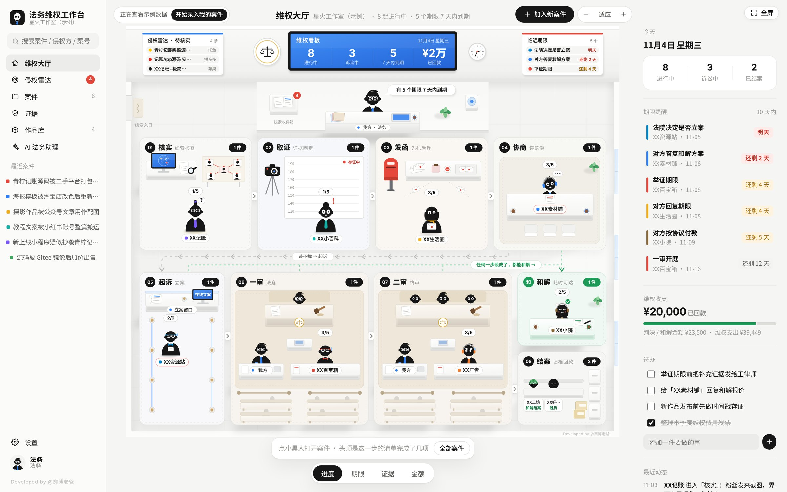
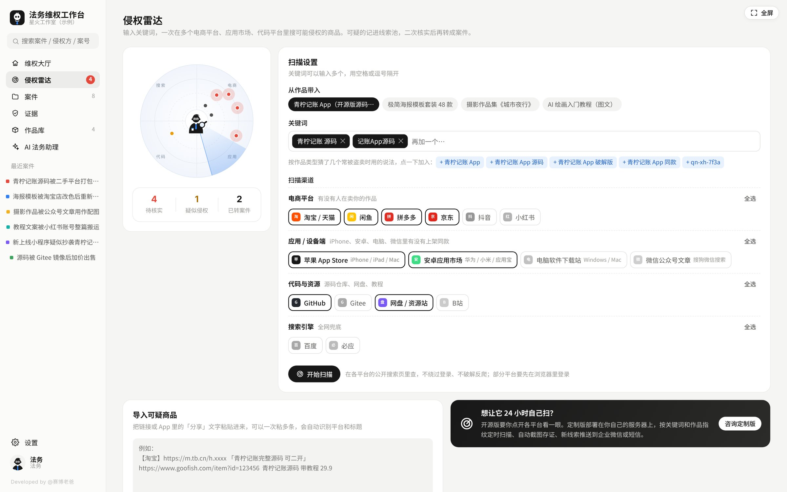
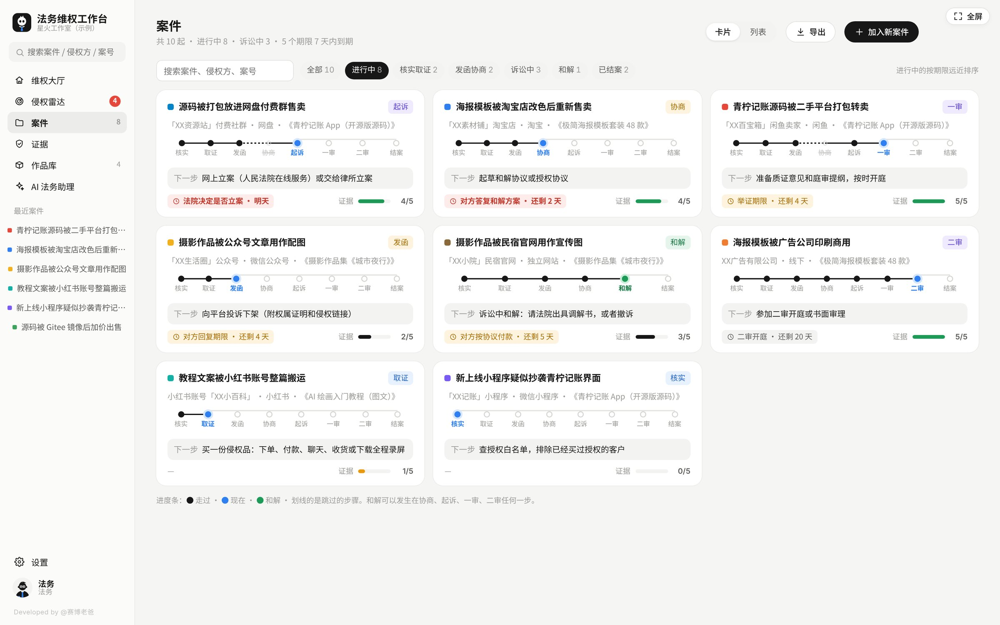
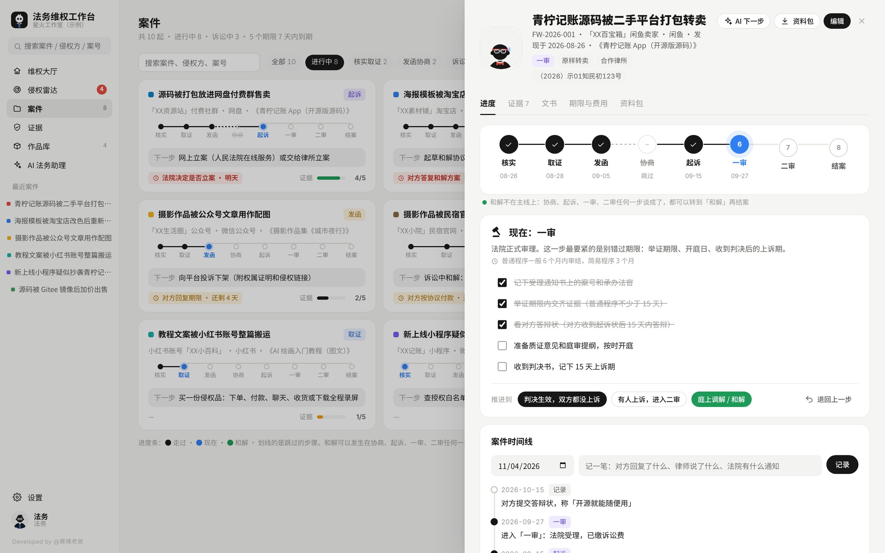

# 法务维权工作台 · workstation-legal

> 个人工作台系列 · v1.1.0 · Developed by @赛博老爸

作品被人盗卖、改皮重卖、整篇搬运了？这个工作台帮你把每一起侵权，从「核实」一步步推进到「结案」：每一步该做什么、哪个期限快到了、证据还缺什么，一眼看清楚。

**只有一个 HTML 文件，双击就能在浏览器里打开，无需安装或注册工作台账号。案件管理等核心功能在本机运行；启用 AI 接口时，相关提问和上下文会发送给你配置的服务商。**

适合独立创作者、软件开发者整理作品授权、疑似侵权线索和案件进展。工作台提供记录、整理和辅助起草功能；侵权雷达需要人工查看搜索结果，工作台不能自动完成取证或法院立案。企业内部部署等商业用途须先取得授权，详见 [LICENSE](LICENSE)。



---

## 快速开始

1. 下载 [最新下载](https://github.com/cyberdaddyleo/workstation-legal/releases/latest) 里的压缩包并解压，或者直接下载本仓库的 `index.html`
2. 用 Chrome 或 Edge 打开 `index.html`
3. 选一个自己的形象，先看示例数据，熟悉后点「开始录入我的案件」清空示例
4. 到「作品库」登记你的作品：发布时间、许可方式、登记号、授权价
5. 到「侵权雷达」输入关键词扫一遍，或者在维权大厅右上角点「加入新案件」

已经在打的官司也能加进来：录入时选「现在进行到哪一步」，比如直接选「一审」，之前没走过的步骤会显示为「跳过」。

---

## 使用方法：从作品登记到案件归档

| 操作 | 在哪里做 | 怎样使用 |
|---|---|---|
| 熟悉界面 | 首次打开后的示例数据 | 先查看大厅和示例案件；准备正式使用时点「开始录入我的案件」。该操作清除示例案件、作品和记录，保留形象与 AI 设置。 |
| 登记作品 | 作品库 | 填写作品名称、发布时间、许可方式等资料，补充授权白名单；证书、原稿和发布文件另行保存。 |
| 整理线索 | 侵权雷达 | 选择作品、输入关键词、生成搜索入口；在平台上人工查看，再粘贴可疑链接或分享文字。完成二次核实后再转成案件。 |
| 录入案件 | 维权大厅 → 加入新案件 | 填写对方和案件资料，选择当前阶段。已有案件可以从实际进展开始录入，无需从头走一遍。 |
| 补充证据 | 案件档案 → 证据 → 添加证据 | 选择类别、记录来源与存证信息，选择本机文件计算 SHA-256 指纹。工作台不保存文件原件，请建立独立的证据文件夹。 |
| 起草文书 | 案件档案 → 文书 | 选择模板，核对自动填入的资料、修改正文，再导出。导出文件为 Word 可打开的 `.doc`（HTML 格式），不是原生 `.docx`；正式提交前请检查排版。 |
| 跟进进展 | 案件档案 → 进度 / 期限与费用 | 勾选已完成清单、记录实际期限和费用，再按真实进展推进阶段。需要时可以退回、转和解或结案。 |
| 整理交接 | 案件档案 → 资料包 | 勾选材料准备情况并导出资料摘要；交接时另行附上证据原件和需要的文书。资料包不会自动打包这些文件。 |

正式起草文书前，可在「设置 → 主体信息」完善权利人及联系方式。文书导出与保存是两个操作：需要保留正文时，点「保存到案件」；「保存并记为已发出」只记录状态和回复期限，不会实际发送函件。

### 配置可选的 AI 助理

1. 打开「设置 → AI 接口」，选择服务商。
2. 填写服务商提供的 API Key、接口地址和当前可用的模型名称。内置预设是填写起点，实际模型权限和可用性以你的服务商账号为准。
3. 点击「测试连接」，成功后再在 AI 助理或文书功能中使用。调用费用按服务商规则计算。
4. 使用本机 Ollama 时，需要先自行安装并启动模型服务，填写本机接口和已安装的模型；本机接口可不填 Key。
5. 暂时不配置接口，或浏览器直连受到跨域限制时，可以使用「复制提示词」，检查内容后粘贴到自己选择的 AI 网页版。

名称替换并不等于完整匿名化：程序只替换已登记案件中的侵权方名称，不会全面过滤自由输入、备注、文书中的电话、邮箱、地址等内容。发送前请自行检查。证据文件的原始内容不会因选择计算指纹而上传。

### 备份、恢复与换电脑

1. 在「设置 → 数据与备份」点击「导出备份」，下载 JSON 文件；证据原件另行备份。
2. 在新电脑或新浏览器打开工作台，进入同一页面，选择「从备份恢复」并选取 JSON 文件。
3. **恢复会覆盖当前全部数据，不会合并。** 如果新环境已有记录，先导出一份备份。
4. **JSON 是未加密的全量备份，包含已保存的 AI API Key、案件、设置及对话等数据。** 请妥善保管，不要上传到公开仓库或直接作为问题反馈附件。

建议固定使用同一浏览器和同一文件位置，定期备份。移动 HTML、使用隐私浏览模式、清理浏览器数据或更换浏览器时，不要假定本地数据会自动迁移。

---

## 主要功能

### 维权大厅

每起案件是一个造型不同的小黑人，站在它当前所处的阶段里：

| 阶段 | 大厅里的样子 |
|---|---|
| 核实 | 站在线索墙前的聚光灯下，头上冒问号 |
| 取证 | 站在身高背景板前，被拍照存证 |
| 发函 | 手里攥着告知函 |
| 协商 | 坐在谈判桌对面 |
| 起诉 | 在立案窗口排队 |
| 一审 / 二审 | 坐在被告席，对面是我方，上面是审判席（二审是三人合议庭） |
| 和解 | 坐在绿色签约桌前 |
| 结案 | 坐在归档柜旁的长椅上，身边写着结果 |

我方法务站在最前面的讲台后，气泡里提醒最近的期限。前墙是维权看板、侵权雷达待核实线索、临近期限。底部可以切换四种视角：**进度**（这一步的清单完成了几项）、**期限**、**证据**（五类证据凑齐了几类）、**金额**。点小黑人就能打开案件。

### 侵权雷达



输入关键词，选好平台，一次生成所有搜索入口，逐个点开看一眼：

| 分组 | 渠道 |
|---|---|
| 电商平台 | 淘宝 / 天猫、闲鱼、拼多多、京东、抖音、小红书 |
| 应用 / 设备端 | 苹果 App Store（iPhone / iPad / Mac）、安卓应用市场（华为 / 小米 / 应用宝）、电脑软件下载站、微信公众号文章 |
| 代码与资源 | GitHub、Gitee、网盘 / 资源站、B站 |
| 搜索引擎 | 百度、必应 |

- 选一个作品，会按作品类型补上常见的盗卖说法（如「源码」「破解版」「同款」「可商用」），并把作品登记里的特征串也当成关键词
- 看到可疑商品，把链接或 App 里的「分享」文字按一行一条粘贴进来；程序从粘贴文字尝试识别平台、标题和价格，不会抓取链接页面，识别不全可手动补充
- 线索池分为待核实、疑似侵权、已转案件、已排除；「二次核实」按名称匹配授权白名单作为提醒，授权作品、范围和有效期仍需人工核对；确认后可一键转成案件

### 案件



所有案件的卡片墙：进度条、下一步、最近期限、证据完整度。按阶段筛选，进行中的按期限远近排序，也可以切换成列表、导出 CSV 表格。CSV 包含全部案件，当前筛选不改变导出范围。

### 案件档案



- **进度**：每一步的清单，做完就推进；走错了可以退回；时间线记下每一次变化
- **证据**：按权属、侵权、比对、损失、主体五类检查证据链；在本机计算文件 SHA-256 指纹，以后可以核对文件有没有被改过
- **文书**：侵权告知函、平台投诉通知、法务函、律师函草稿、和解协议、著作权许可协议、起诉状草稿、证据目录，按案件信息自动填好，可导出 Word
- **期限与费用**：常见期限一键添加，诉讼时效自动提醒；维权支出记账，区分可以向对方主张的合理开支；附赔偿金额的计算参考
- **资料包**：9 项材料准备清单，可导出案件、权属、证据目录、费用和时间线等摘要；证据原件和已起草文书需另外整理后交接

### 作品库

登记作品和授权白名单。核实线索时提供名称匹配提醒，帮助排查已获授权的客户；不会自动判断授权范围或有效期。

### AI 法务助理

侵权初判、下一步建议、赔偿测算思路、起草函件、回函应对、和解谈判、起诉状要点、证据补强、公开发声审稿。

- 提供 DeepSeek、通义千问、Kimi、智谱 GLM、豆包、硅基流动、OpenAI、Claude、Ollama 等预置配置；实现 Chat Completions 兼容接口及 Anthropic Messages 接口调用。实际可用性取决于模型权限、额度、接口参数和浏览器跨域设置
- 不配置接口也能用：「复制提示词」粘贴到 AI 网页版
- 启用名称替换时，发送前把已登记的侵权方名称换成【对方01】这样的编号，回答里再换回来；该功能不保证其他个人信息已移除

---

## 一起案件会经过哪些步骤

| 工作台阶段 | 建议记录的内容 |
|---|---|
| 核实 | 作品权属、授权情况、线索来源与核实结果 |
| 取证 | 证据目录、来源、文件指纹、存证信息 |
| 发函 | 投诉或函件草稿、发送记录、回复情况 |
| 协商 | 沟通纪要、对方反馈、拟定方案 |
| 起诉 | 材料准备与实际立案进展 |
| 一审 / 二审 | 案件通知、实际期限、庭审和裁判进展 |
| 结案 | 履行情况、结案结果与归档记录 |

工作台中的阶段、清单与常见期限属于辅助参考。实际期限请以适用规定、案件通知及专业人员核实结果为准，不要把默认提醒当作个案判断。

**和解是分支**：协商、起诉、一审、二审任何一步谈成了，都可以转到「和解」，履行完就结案。

不是每起案件都要走完全程：对方收到告知函就下架的，可以直接结案；证据充分、对方态度恶劣的，可以跳过发函直接起诉；一审判决后双方都不上诉的，二审显示为「跳过」。

---

## 数据与隐私

- 案件、作品、证据台账和设置默认保存在当前浏览器的 localStorage 中，没有工作台自建的云端同步服务；使用 AI 时会发送相应提问和上下文
- 证据文件本身不会上传，也不会存进工作台，只记下它的 SHA-256 指纹。**原件请自己妥善保存**
- 配置并调用 AI 接口时，提问与所选案件上下文直接从浏览器发给配置的接口；文书润色会发送文书正文。名称替换只覆盖已登记的侵权方名称，不等于完整脱敏
- API Key 保存在浏览器本地设置中，也会进入未加密的 JSON 备份；请勿分享备份或把它提交到 GitHub
- 清理浏览器数据或换电脑之前，请到「设置 → 数据与备份」导出备份

---

## 使用提醒

- 工作台里的清单、文书模板和 AI 回答只是参考，**不构成法律意见**
- 律师函只能由执业律师审核后，以律师事务所名义签发；工作台只生成草稿
- 网上立案需要本人在「人民法院在线服务」完成实名认证和人脸核验，工作台不能代为提交
- 侵权雷达只打开各平台公开的搜索页面，不绕过登录、不破解反爬；部分平台要先在浏览器里登录才能看到结果
- 管辖法院、诉讼请求金额、证据效力等，请交给律师确认
- 维权期间公开发声，只陈述能证明的事实，避免在判决前给对方下结论
- 示例数据里的侵权方都用「XX百宝箱」「XX小程序」这类虚构名称，与任何真实店铺、账号、公司无关

---

## 源码公开版和定制版

| | 源码公开版（本项目） | 定制版 |
|---|---|---|
| 侵权线索 | 侵权雷达生成各平台搜索入口，你点开看、手动导入 | 24 小时按关键词和作品指纹定时扫描，自动截图存证，新线索推送到企业微信或短信 |
| 取证 | 本机计算指纹 + 证据台账 | 自动快照 + 时间戳 / 区块链存证 |
| 协作 | 导出资料包 | 对接公司法务审批、合作律所 |
| 部署 | 浏览器打开即用 | 本地化部署在你自己的服务器上 |

需要定制版：cyberdaddyleo@outlook.com

---

## 常见问题

**换电脑或换浏览器，数据还在吗？**
不在。数据跟着浏览器走。先在旧电脑「设置 → 数据与备份」导出备份文件，再到新电脑导入。

**AI 功能要花钱吗？**
个人非商业使用工作台免费，商业使用需授权。AI 接口按服务商计费；也可以使用「复制提示词」，粘贴到自己选择的 AI 网页版。网页 AI 是否免费以对应服务为准。

**手机能用吗？**
以电脑为主设计，推荐用电脑上的 Chrome 或 Edge。

**为什么侵权雷达不自动扫？**
源码公开版不做后台自动抓取，只打开各平台的公开搜索页，由你自己看。需要 24 小时自动监测的，可以联系定制版。

---

## 文件说明

```
├── index.html     工作台本体（单文件，无外部依赖）
├── README.md      软件介绍与使用说明
├── LICENSE        许可协议
└── docs/          截图
```

---

## 许可

本项目公开源代码，采用自定义许可协议，包含商业使用限制；不是 MIT、Apache 等许可。

个人可以免费使用、修改和二次开发；**商业使用需要获得作者书面授权**。分享或修改时请保留「Developed by @赛博老爸」署名和许可协议全文。详见 [LICENSE](LICENSE)。

商业授权、定制开发：cyberdaddyleo@outlook.com

全网渠道：@赛博老爸 · 个人工作台系列
